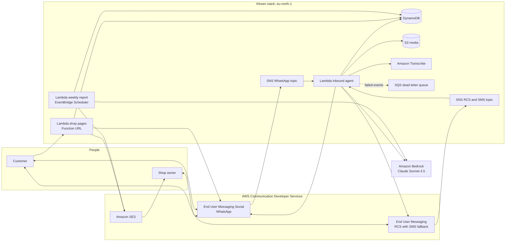

# Vitreen

Vitreen is a counter assistant for independent shops that lets the owner run her business from WhatsApp with nothing more than a photo or a voice note, while her customers reach the shop on WhatsApp, RCS, SMS or a simple web page and every request the shop could not serve ends up in a demand report waiting in her inbox on Monday morning.

It was created for the AWS CDS Agentic AI Partner Hackathon in October 2026 by boxboxd, an AWS Partner (Partner Central opportunity O29986149).

## How can I try it as a judge?

- **WhatsApp:** message `WHATSAPP_NUMBER` with `Boulangerie Martin boulangerie-martin-a1b2` and ask anything in any language, for example "Do you still have pistachio flan?" followed by "Yes, tell me when it is back".
- **Web page of the demo shop:** https://dtaxovn7ivekfasgtxirj42sam0xcrdc.lambda-url.eu-north-1.on.aws/s/boulangerie-martin-a1b2 is the page the agent created from the menu, shown in your browser language and taking real pickup orders.
- **RCS:** our RCS agent is still at the testing stage and only reaches registered test devices, so send your number to partnerships@boxboxd.fun and we will add you as a tester within minutes.
- **Demo video:** `VIDEO_URL`

There is nothing to install and nothing to pay and the whole stack runs in eu-north-1.

## What problem does it solve?

A baker opens at seven and serves without a break until noon, so the phone that rings during the rush goes unanswered and the chalkboard by the door, rewritten every morning, never matches the prices on a website that was last updated a month ago. Customers ask the same three questions on Instagram, on Google and on WhatsApp and when the pistachio flan runs out at ten the people who came for it simply leave without anyone knowing they were there.

These shops already live on WhatsApp and have no time to learn a dashboard, so Vitreen meets them where they are and turns each conversation into structured information the owner can act on.

## What does it do?

**For the owner, on WhatsApp**
1. She sends a photo of her chalkboard and Claude on Amazon Bedrock reads every product and price, which puts the shop page online with pickup ordering in under a minute.
2. She updates it the way she talks, typing "no more croissants" or "flan is 4.50 now" or saying the same thing in a voice note that Amazon Transcribe turns into text and Vitreen tells her what it heard and what changed so she can write "undo" if it is not what she meant.
3. New orders reach her with Accept and Decline buttons, followed by an "Order ready" button that lets the customer know the moment it is done.
4. Every Monday at seven an email sent through Amazon SES gives her the orders by channel, the products people asked for while they were sold out, the questions she could not answer and one concrete suggestion written by Claude.

**For the customer, on any channel**
1. A QR code in the window opens WhatsApp with the shop code already typed and the web page lets anyone order with a phone number instead.
2. The agent answers only from the shop's own menu and opening hours, never inventing a price, an ingredient or an allergen and hands anything it cannot answer over to the owner.
3. It takes orders, puts customers on a waitlist for sold out products and writes to them again when the owner marks the product as back.
4. It answers in the customer's own language, so someone writing in English to a Paris bakery gets English replies.

## Why use more than one channel?

WhatsApp only accepts free form business messages within 24 hours of the customer's last message, which means Meta rejects a waitlist alert sent three days later or an order update sent to someone who ordered on the web. Vitreen remembers when each contact last wrote and chooses the channel for every notification: WhatsApp while the window is open, then RCS through AWS End User Messaging, which falls back to SMS on its own when a phone does not support RCS.

The same logic protects the owner. If she has been silent for a day, a new order reaches her by text with a prompt to write "orders" on WhatsApp and Vitreen then sends every pending order again with its buttons. A customer who answers an RCS message carries on the same conversation with the same history, because conversations are tied to the phone number rather than to the channel.

## Architecture



A single Lambda function handles every inbound message whatever the channel: `src/lib/events.mjs` turns WhatsApp webhooks and RCS or SMS payloads into one message shape and `src/lib/channels.mjs` decides how each answer goes out.

## Where is each AWS service called?

- **AWS End User Messaging Social (WhatsApp):** `@aws-sdk/client-socialmessaging` in `src/lib/aws.mjs`, with `SendWhatsAppMessage` for text and interactive buttons and `GetWhatsAppMessageMedia` to store photos and voice notes in S3.
- **AWS End User Messaging (RCS and SMS):** `@aws-sdk/client-pinpoint-sms-voice-v2` in `src/lib/aws.mjs`, where `SendTextMessage` uses the RCS agent or a pool as origination identity, while inbound RCS arrives through the two way SNS topic.
- **Amazon SES:** `@aws-sdk/client-sesv2` in `src/lib/aws.mjs` for order receipts from the web page and the weekly demand report, signed with DKIM on boxboxd.fun.
- **Amazon Bedrock:** the Converse API with tool use in `src/lib/ai.mjs` for reading photos and applying edits, in `src/lib/agent.mjs` for the customer agent and its `place_order`, `notify_when_available` and `pass_question_to_shop` tools and in `src/lib/digest.mjs` for the weekly insights.
- **Amazon Transcribe:** voice notes in `transcribeAudio` inside `src/lib/aws.mjs`.
- **DynamoDB, S3, Lambda, SNS, SQS, EventBridge Scheduler, CloudWatch and X-Ray:** all declared in `template.yaml`.

## How is it made safe to run?

Each function only receives the actions it calls, scoped to the WhatsApp number, the SES domain, the table and the bucket. Every inbound message id is claimed with a conditional write so that a retried webhook never produces a second reply, order states move through conditional updates and only the owner of a shop can accept its orders.

The agent cannot invent anything that matters: prices are parsed and capped, menus are cleaned before they are saved and an order can only contain product ids that exist and are available. Web orders have a size limit, a honeypot field and a ceiling of 30 orders per shop every 10 minutes and the pages are served with a strict Content Security Policy that allows no scripts at all.

All data stays in Stockholm and Claude is called through the EU inference profile, with conversations expiring after 30 days and demand records after 90. Failed events go to a dead letter queue, three CloudWatch alarms watch agent errors, page errors and that queue before emailing the team and every function writes JSON logs with X-Ray tracing turned on.

While the Bedrock quota of our new account is being raised, the functions assume a role in another account of our AWS Organization that can only call `bedrock:InvokeModel` on Anthropic models in EU regions and only accepts roles named `vitreen-*`. Emptying the `BedrockRoleArn` parameter switches everything back to local calls.

## How do I deploy it?

You need an AWS account with End User Messaging and Bedrock access to Claude, Node.js 22 and the AWS SAM CLI.

```bash
npm install
npm test
sam build
sam deploy --guided --stack-name vitreen --capabilities CAPABILITY_IAM
```

- `PhoneNumberId` and `BusinessPhone` describe the WhatsApp number linked in End User Messaging Social.
- `MessagingPoolId` takes a pool that holds your RCS agent and an SMS number or the RCS agent ARN on its own while you are testing.
- `SenderEmail` and `SenderDomain` point to a domain verified in SES.
- `BedrockModelId` accepts any Bedrock model that reads images and supports tool use, with `eu.anthropic.claude-sonnet-4-5-20250929-v1:0` as the default.
- `BedrockRoleArn` is optional and described above, as is `OpsEmail`, which receives the alarms.

After the first deploy, set the event destination of the WhatsApp number to the `WhatsAppTopicArn` output and the two way destination of the RCS agent to `TextInboundTopicArn`:

```bash
aws pinpoint-sms-voice-v2 update-rcs-agent --rcs-agent-id <id> \
  --two-way-enabled --two-way-channel-arn <TextInboundTopicArn>
```

## How is it tested?

`npm test` runs 37 tests with the Node.js test runner and mocked AWS clients, following the owner and the customer from start to finish: a page created from a single photo, a waitlist alert when the flan comes back, an order accepted and then marked ready, a stranger trying to accept someone else's order, duplicate webhooks, a customer silent for two days who is reached over RCS, an RCS reply that continues the same conversation, a web order followed up over RCS, an owner silent for a day, a menu changed by voice note, RCS typing events that are ignored and the English page served to an English browser.

## How does a partner sell it?

Vitreen is shaped as a repeatable offer for AWS Partners who work with small merchants, such as chambers of commerce, bakery and butcher networks, payment providers or local agencies. One stack serves every shop in a network and onboarding a new shop costs nothing because the owner only sends a photo, while the weekly report gives the network something it never had before: a shop by shop view of what customers asked for and could not get.

## What comes next?

- WhatsApp payment links for pickup orders.
- A country launch of the RCS agent in France once the carriers approve it.
- Message templates approved by Meta for back in stock alerts.
- Opening hours that update themselves from the owner's voice notes, such as "closed on Monday for the holidays".

## A word for the jury

The panel has fifteen members and most of them work on the very services Vitreen depends on: Marie Carlton, Sara Caleffi, Tom Sly, Morgan Pomerantz, Yaniv Bossem, Kathleen Winder, Jimmy Nimo, Robert Gray, Raman Dhillon, Medha Karri, Matt Burdick, Alexis Perry, Zip Zieper, Puneet Badlani and Sandeep Akhouri.

That matters to us more than the prize itself. RCS in End User Messaging opened to businesses this year, the SMS fallback inside a pool is what lets an independent baker reach every customer without ever hearing the word RCS and the two way SNS topic is what allows a single Lambda function to hold one conversation across WhatsApp and RCS. Those services come from the product, engineering and go to market teams represented on this panel and Vitreen is a small test of what they make possible for a shop with no IT at all. Your feedback is the closest thing we will get to a review from the people who know where these services are heading and we would be grateful to hear what you would change.

## License

MIT, see [LICENSE](LICENSE). The repository was created during the hackathon submission period, with a first commit on October 20, 2026.
